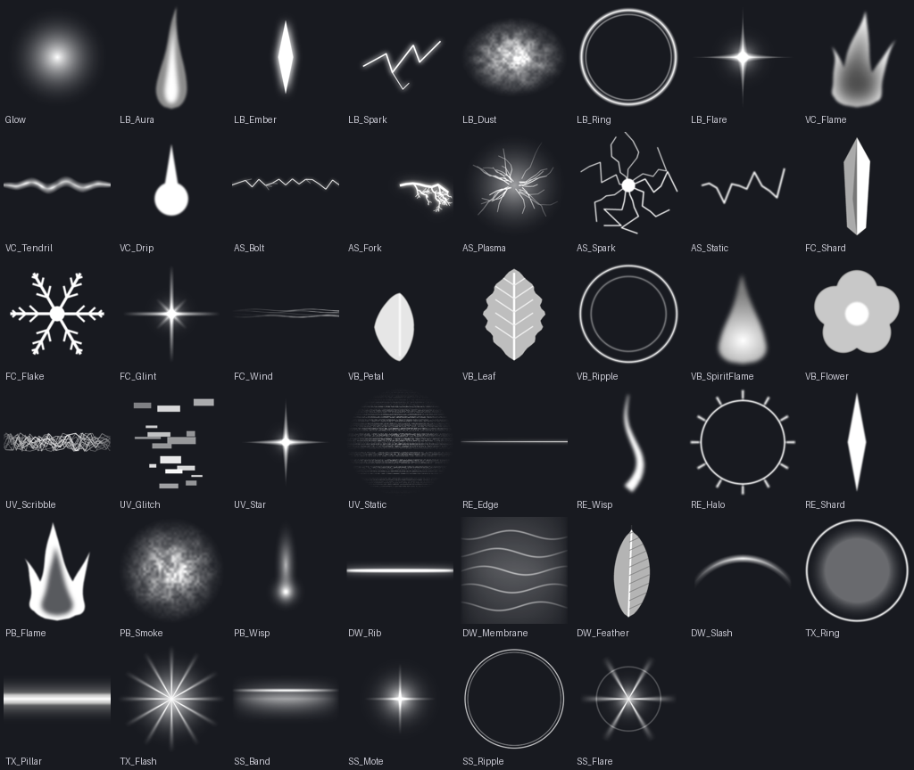

# Eternium Auras

The ten player auras, rebuilt from scratch. No Creator Store packs and no meshes: every aura is built
by `EterniumAuras.lua` out of particles, beams, trails and lights riding the body parts (R15 and R6),
and animated every frame.

The rules every aura follows:
- **Individual:** each aura has its **own textures** and its **own signature motion**. No layer is
  shared between auras. The test suite checks that no texture is used by two of them (the soft haze
  texture aside).
- **Recolourable** from the three picks:
  - **Main:** the body of the aura.
  - **Accent:** sparks and details.
  - **Glow:** outline, haze and the light it casts.
- **Stage 2** changes each aura in its own way, and switching stages re-plays the ignite effect.



Simulated previews (real textures and the module's settings, rendered outside Roblox):
[Limit Breaker](previews/LimitBreaker.mp4) · [Azure Surge](previews/AzureSurge.mp4).
Render more with `python tools/preview_aura.py OUT_DIR`.

## The ten auras

| Aura | Signature (Stage 1) | Stage 2 |
|---|---|---|
| **Limit Breaker** (default) | **A Super Saiyan aura:** a blazing envelope of tall, flickering flame-spikes rising off the whole body, white-hot at the core and widening into an oval round the silhouette. Golden embers shoot upwards, dust kicks up at the feet and the light throbs | **Super Saiyan 2:** the aura grows taller, denser and faster, **blue-white bioelectric sparks** crackle round the body and **pressure rings** burst along the ground |
| **Void Current** | Dark flames with black edges rise off the limbs while the darkness **drips off the hands and body and pools at the feet** in a slow, rotating whirl | **Shadow tendrils writhe** from the hands down into the pool |
| **Azure Surge** | **Raw electrical power:** branching lightning **bursts out of the body in every direction**, arcs leap between the limbs, **bolts strike the ground** around the feet with a flash, and a crackling plasma field wraps the body under a hard, flickering light | Both arms become **storm conduits** wrapped in continuous lightning, **twice as many bolts** fly, and a **ring of static spins above the head** |
| **Frost Crown** | A **crown of ice crystals hovers and turns above the head**. Cold wind circles the body, ice forms on the limbs and breaks off, snowflakes drift and glints sparkle | A **taller, wider crown** (11 crystals), **crystal pauldrons** on the shoulders and a thicker blizzard |
| **Verdant Bloom** | Soft **ripples spread from the feet** while **petals spiral up out of them in a slow vortex**, and leaves tumble round the body | **Flowers bloom** on the shoulders and head, and a gentle **spirit flame** rises from the ring of ripples |
| **Umbral Veil** | Wings of **frantic scribbled shadow** twitch on the back, redrawn many times a second. Static fizzes at the body's edges and stars wink, framing the body without covering it | The shadow **tears**: glitch blocks burst off the body, and the wings jump and split into an offset ghost copy |
| **Radiant Edge** | Razor-thin lines of light **run up the edges of every limb over and over**, as if the body were being drawn in light, under a slowly turning **halo**, with dark wisps licking off | The tracing quickens, a **second halo counter-rotates** and **shards of light** fly off |
| **Phantom Blaze** | **Hollow, bright-edged ghost fire** clings to every limb over a smoky core, while **will-o'-wisps drift round the body in slow figure-eights** | The **hands erupt into towering phantom fire**, and the wisps multiply and quicken |
| **Dusk Wings** | Two great **wings of glowing ribs and see-through light membrane** beat slowly from the upper back, shedding feathers, while **crescent blades of light slash the air** around the body | The wings **span wider** and a **second, smaller pair** opens below them, with twice as many slashes |
| **Silver Sheen** | **Bands of sheen slide up the limbs** like light across polished metal, with silver dust settling round the body | **Mercury ripples roll up the body** ring by ring, bright **flares glint** on the limbs, and silver crackles off |

## Setup

### 1. Upload the textures (once)
1. In Studio, open **View → Asset Manager → Bulk Import** and select every PNG in `textures/`
   (all except `_contact_sheet.png`).
2. Copy each image's asset ID (right-click → Copy Asset ID).
3. Paste each ID into `EterniumAuras.Textures` at the top of the module, as
   `LB_Trail = "rbxassetid://123..."` and so on.

Any texture left empty falls back to a built-in Roblox texture, so the auras work straight away.
They'll only look truly individual once the uploads are in.

### 2. Add the module
Put `EterniumAuras.lua` in `ReplicatedStorage.Eternium` as a ModuleScript named `EterniumAuras`.
Optionally fill `EterniumAuras.Sounds` with your existing ignite and loop sounds:

```lua
EterniumAuras.Sounds.LimitBreaker = { Ignite = "rbxassetid://...", Loop = "rbxassetid://..." }
```

### 3. Drive it with attributes (recommended)
The auras animate every frame, so they should run on each player's own client. The server only says
which aura someone wears:

```lua
-- server, wherever the aura is equipped / recoloured / empowered
character:SetAttribute("Aura", "FrostCrown")    -- "" removes it
character:SetAttribute("AuraStage", 2)
character:SetAttribute("AuraMain", Color3.fromRGB(180, 230, 255))
character:SetAttribute("AuraAccent", Color3.fromRGB(255, 255, 255))
character:SetAttribute("AuraGlow", Color3.fromRGB(100, 180, 255))
```

```lua
-- one LocalScript (e.g. StarterPlayerScripts)
require(game.ReplicatedStorage.Eternium.EterniumAuras).watch()
```

`watch()` builds, recolours, re-stages and removes every player's aura as those attributes change,
including on respawn.

### Or drive one directly

```lua
local EterniumAuras = require(game.ReplicatedStorage.Eternium.EterniumAuras)
local aura = EterniumAuras.apply(character, "DuskWings", { Main = ..., Accent = ..., Glow = ... }, 1)
aura:SetStage(2)
aura:SetColors({ Glow = Color3.fromRGB(255, 90, 140) }) -- any picks you leave out are kept
aura:Destroy()
```

Aura names: `LimitBreaker`, `VoidCurrent`, `AzureSurge`, `FrostCrown`, `VerdantBloom`, `UmbralVeil`,
`RadiantEdge`, `PhantomBlaze`, `DuskWings`, `SilverSheen`.

### 4. Transformations (`EterniumTransform.lua`)
Every aura gets the same 3.5-second transformation spine, plus its own build-up and finish.

| Time | Phase | What happens |
|---|---|---|
| 0 – 3 s | **Build-up** | The ground cracks outward, rocks tear loose and float, the air shakes, the charge glow swells, streams of energy spiral in, and the player can't move |
| 3 s | **Burst** | A blinding flash, two shockwaves across the ground, a pillar of light, and the rocks blasted away |
| 3 – 3.5 s | **Settle** | The player lands in the powered-up stance while the debris keeps flying |

**The transforming player gets a cinematic:**
- Four camera shots:
  - Low orbit at the front.
  - High and wide from behind.
  - A push-in to the face.
  - A wide cut at the burst with an FOV punch.
- A shake that builds up, a colour grade that drains then pops, and a screen flash.
- At 3.5 s the camera blends back to the player's own view.

**Everyone else** sees all the effects, but their camera is never touched.

**The character acts it out**, with no animation uploads needed. The module poses the character's own
joints every frame, on every client, so all players see the same performance:

| Time | What the body does |
|---|---|
| 0 – 0.3 s | Snaps into a wide power stance, fists pulled to the hips |
| 0.3 – 2.6 s | Sinks deeper into a crouch, straining: the head drops, the chest heaves, the body trembles harder and harder |
| 2.6 – 3 s | Coils inward with arms crunched to the chest and head down |
| 3 s | Explodes upward into a short hop: arms flung up and back, chest arched, head thrown back in a roar |
| 3 – 3.5 s | Lands in the powered-up stance, then blends back into the player's own animations |

Radiant Edge raises its sword hand to the sky while the blade forms, and the arm delivers the slash.

It works on R15 and R6. R6 rigs have no knees, so they pose upright without the crouch.
Supplying your own `EterniumTransform.Animations` switches the procedural performance off and plays
those instead. The keyframes are plain tables in `EterniumTransform.Performances` if you want to tweak
them.

Preview of all ten as the transforming player sees them: [Transformations.mp4](previews/Transformations.mp4).
It's rendered outside Roblox from the module's own frame-by-frame output, with real textures and a plain blocky dummy.

| Aura | Build-up | Finish |
|---|---|---|
| Limit Breaker | Lightning strikes down faster and faster, arcs crawl over the ground from the feet | A giant strike with four side bolts |
| Azure Surge | A storm cloud gathers overhead, arcs crackle round the body, lightning lashes the ground | Twelve bolts burst outwards |
| Phantom Blaze | Flames burst from the ground in a widening, turning ring | A roar of fire and a central flame jet |
| Frost Crown | Ice crystals erupt in a widening ring | The crystals shatter outward into bright shards |
| Verdant Bloom | Leaves and petals whirl up, faster and faster | A leaf explosion and a ripple |
| Void Current | Dark tendrils reach up and a sphere of darkness closes in | The sphere shatters and dark flame bursts out |
| Umbral Veil | Tendrils and the closing darkness, fizzing with static | The sphere shatters into glitch static |
| Silver Sheen | Columns of light rise; rings pulse like a speeding heartbeat | The columns collapse into a silver flare |
| Dusk Wings | A wind funnel twists up round the body | Two wings of light sweep open |
| Radiant Edge | A sword of light forms in the raised hand | One slash with a light trail, then the blade dissolves |

**Setup:**
1. Put the module next to `EterniumAuras` in `ReplicatedStorage.Eternium` as a ModuleScript named
   `EterniumTransform`.
2. Add a RemoteEvent, for example `ReplicatedStorage.Eternium.TransformEvent`.
3. Wire it up:

```lua
-- server: start the transformation everywhere, then empower at the 3-second burst
TransformEvent:FireAllClients(character, "FrostCrown", { Main = main, Accent = accent, Glow = glow })
task.delay(3, function()
	character:SetAttribute("AuraStage", 2) -- and any gameplay buffs
end)
```

```lua
-- client (the same LocalScript that calls EterniumAuras.watch())
local EterniumTransform = require(game.ReplicatedStorage.Eternium.EterniumTransform)
TransformEvent.OnClientEvent:Connect(function(character, aura, colors)
	EterniumTransform.play(character, aura, colors)
end)
```

**Behaviour:**
- Only the player's own client moves their camera and freezes their movement.
- Walk speed, jump and camera are restored at 3.5 s, and also if the transformation is cancelled
  (`handle:Cancel()`) or the character despawns mid-way.
- `play` also takes `{ onBurst = fn, onFinished = fn }`.

**Optional extras:**
- Animations: fill `EterniumTransform.Animations` (`Buildup`, `Burst`, `Stance`).
- Sounds, per aura: `EterniumTransform.Sounds.FrostCrown = { Buildup = "rbxassetid://...", Burst = "rbxassetid://..." }`.

It uses the `TX_Ring`, `TX_Pillar` and `TX_Flash` textures, plus each aura's own, from `EterniumAuras.Textures`.

### 5. Retire the old system
Once the new auras are in, the old invisible-accessory auras and the packs in
`ReplicatedStorage.Eternium.Assets.Auras` (including the unused Spiky and GoldSpiky) can be removed.

## Tweaking
- `EterniumAuras.Defaults`: each aura's default Main, Accent and Glow.
- `EterniumTransform.Signatures.<Aura>`: each aura's transformation build-up and finish.
- `EterniumAuras.Designs.<Aura>`: each aura's layers (`build`), motion (`update`) and ignite burst
  (`ignite`), all written out by hand so you can adjust rates, sizes and speeds directly.
- Textures are regenerated with `python tools/build_aura_textures.py`.
