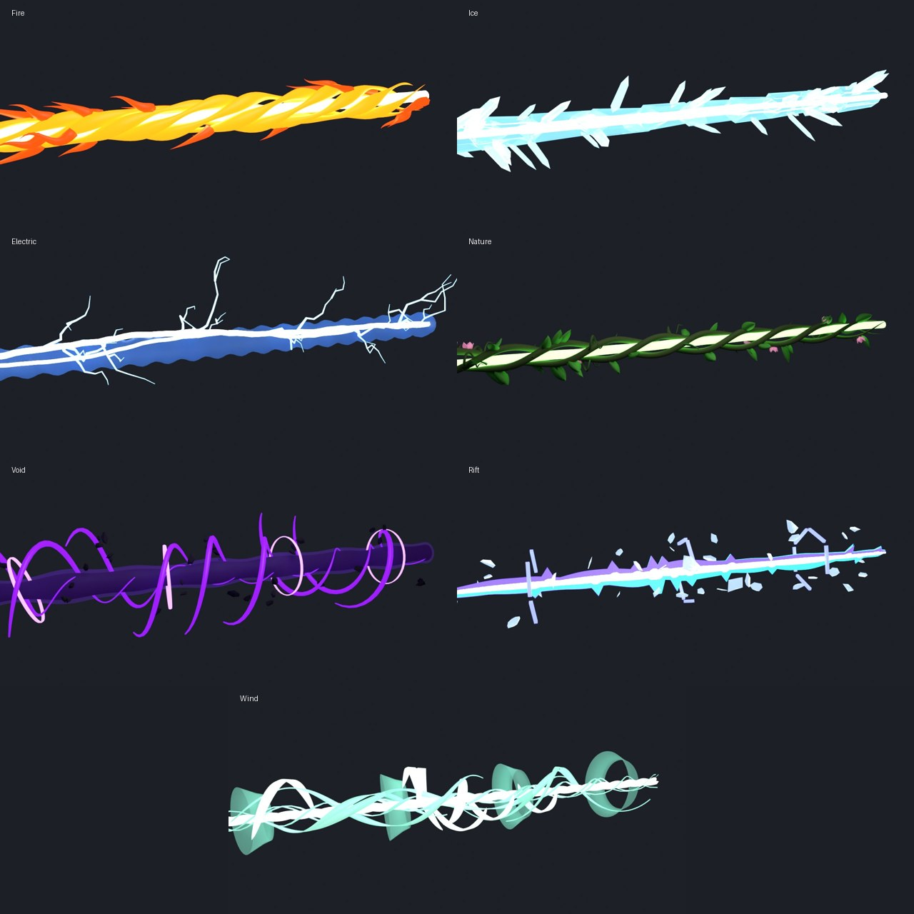

# Element Beams

One Blender-made 3D beam per Eternium element, plus a module that drops them into the game.



| Element | Look | Parts |
|---|---|---|
| **Fire** | No solid tube: a white-hot core wrapped in five twisting flame tongues, with flame wisps streaming backwards | Core, Flames, Wisps |
| **Ice** | A crystalline spear of overlapping hexagonal crystals, with shards jutting forward | Core, Crystal, Shards |
| **Electric** | Two intertwined jagged bolts, forking branches and a pulsing plasma sheath | Bolt, Branches, Sheath |
| **Nature** | Three thorned vines braiding around a living green core, with leaves, curling tendrils and blossoms | Core, Vines, Leaves, Blossoms |
| **Void** | A light-eating black core inside a violet event horizon, tendrils spiralling inward, orbit rings and debris | Core, Horizon, Tendrils, Rings, Debris |
| **Rift** | A twisting tear in space with offset indigo/cyan edges, broken-glass fragments and cracked hexagonal gates | Tear, EdgeMagenta, EdgeCyan, Fragments, Gates |
| **Wind** | A tightly wrung three-strand core of air, airflow streaks spiralling round it, translucent shockwave rings and crescent wind blades | Core, Streams, Rings, Blades |

Every model is 24 units long and stays well under Roblox's 20k-triangle limit per part.
Each also has two tiny `Start`/`End` marker parts, which the module uses to aim the beam.

## Getting them into Studio

1. **Import** each `*.fbx` in this folder with Studio's 3D Importer (Home → Import 3D). You can
   select all seven at once. The default settings are fine: scale and orientation don't matter,
   because the module reads the markers.
2. Create a Folder named **`ElementBeamModels`** in `ReplicatedStorage` and move the seven imported
   models into it. Keep the names (`FireBeam` or `Fire` both work) and the part names inside.
3. Add **`ElementBeams.lua`** to `ReplicatedStorage` as a ModuleScript named `ElementBeams`.
4. In a beam script, replace the old beam-building code with:

```lua
local ElementBeams = require(game.ReplicatedStorage.ElementBeams)

-- origin = hand position, hitPosition = where your raycast landed
ElementBeams.fire("Fire", origin, hitPosition)
-- optional: { width = 1.5, hold = 0.5, fadeIn = 0.08, fadeOut = 0.25, parent = someFolder }
```

The module colours each part by name (see `ElementBeams.Styles`: Neon cores, ForceField sheaths,
Glass crystals and so on). It stretches only the beam's length, so flames, shards and leaves keep
their shape. It also rolls Fire, Nature, Void, Rift and Wind around their own axis while they're
visible. Tune colours, materials and spin speed in the `Styles` table.

`ElementBeams.place(element, origin, target, width)` returns a positioned beam without animating
it, for channelled beams that you update yourself.

## Changing the models

The models are generated by `tools/build_element_beams.py`. Edit it, then rerun:

```sh
pip install bpy                                   # Blender as a Python module
python tools/build_element_beams.py --render     # rewrites the .fbx files and preview renders
```
