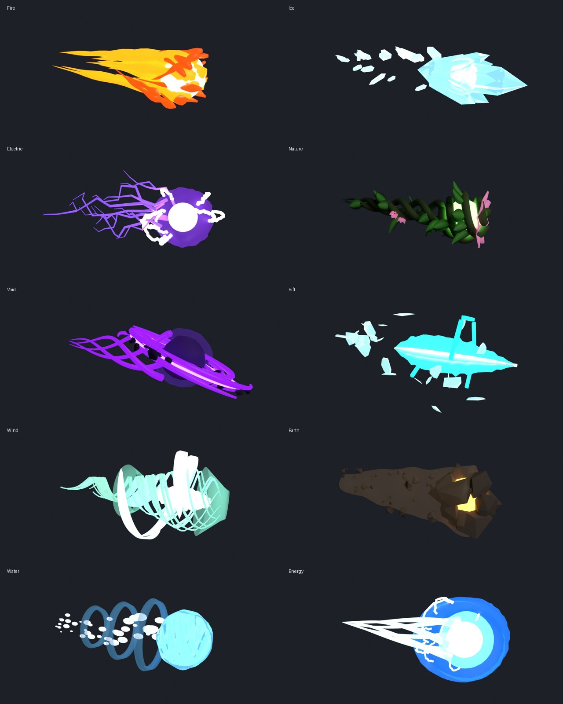

# Element Beams

One Blender-made 3D beam per Eternium element, plus a module that drops them into the game.


| Element | Look | Parts |
|---|---|---|
| **Fire** | No solid tube: a white-hot core wrapped in five twisting flame tongues, with flame wisps streaming backwards | Core, Flames, Wisps |
| **Ice** | A crystalline spear of overlapping hexagonal crystals, with shards jutting forward | Core, Crystal, Shards |
| **Electric** | A thick white-hot jagged main bolt with a thinner one twisting round it, violet forking branches and a pulsing purple plasma sheath | Bolt, Branches, Sheath |
| **Nature** | Three thorned vines braiding around a living green core, with leaves, curling tendrils and blossoms | Core, Vines, Leaves, Blossoms |
| **Void** | A light-eating black core inside a violet event horizon, tendrils spiralling inward, orbit rings and debris | Core, Horizon, Tendrils, Rings, Debris |
| **Rift** | A faceted, star-shaped crystal fracture with a glowing fault line through it, caged by angular cyan crack lines, with solid glass shards and cracked hexagonal gates | Core, Tear, EdgeMagenta, EdgeCyan, Fragments, Gates |
| **Wind** | A tightly wrung three-strand core of air, airflow streaks spiralling round it, translucent shockwave rings and crescent wind blades | Core, Streams, Rings, Blades |
| **Earth** | A torrent of craggy rock spiralling round a molten fault line with glowing veins, wrapped in churning dust | Core, Rocks, Pebbles, Dust |
| **Water** | A high-pressure jet: a turbulent translucent stream, three twisting water ribbons, foam streaks and spray, a rippling outer sheath | Core, Spiral, Foam, Sheath |
| **Energy** | A Kamehameha-style ki beam: a blinding white core in layered glow, a rippling aura, coiling energy, a charged ball at the hands and a bulbous head at the front (both stay round however long the beam is) | Core, Glow, Aura, Coils, Head, HeadCore, Muzzle |

Every model is 24 units long and stays well under Roblox's 20k-triangle limit per part.
Each also has two tiny `Start`/`End` marker parts, which the module uses to aim the beam.

## Getting them into Studio

1. **Import** each `*.fbx` in this folder with Studio's 3D Importer (Home → Import 3D). You can
   select them all at once. The default settings are fine: scale and orientation don't matter,
   because the module reads the markers.
2. Create a Folder named **`ElementBeamModels`** in `ReplicatedStorage` and move the imported
   models into it. Keep the names (`FireBeam` or `Fire` both work) and the part names inside.
3. Add **`ElementBeams.lua`** to `ReplicatedStorage` as a ModuleScript named `ElementBeams`.
4. In a beam script, replace the old beam-building code with:

```lua
local ElementBeams = require(game.ReplicatedStorage.ElementBeams)

-- origin = hand position, hitPosition = where your raycast landed
ElementBeams.fire("Fire", origin, hitPosition)
-- optional: { width = 1.5, hold = 0.5, fadeIn = 0.08, fadeOut = 0.25, parent = someFolder,
--            color = Color3.fromRGB(255, 220, 60) }
```

**Recolouring:** pass `color` to `fire`, `place` or `blast` and the element's glowing parts take
that colour (a golden Kamehameha, green water, blue magma...). `ElementBeams.Recolorable` lists
which parts each element repaints, and `Styles` holds the defaults.

The module colours each part by name (see `ElementBeams.Styles`: Neon cores, ForceField sheaths,
Glass crystals and so on). It stretches only the beam's length, so flames, shards and leaves keep
their shape. It also rolls Fire, Nature, Void, Rift and Wind around their own axis while they're
visible. Tune colours, materials and spin speed in the `Styles` table.

`ElementBeams.place(element, origin, target, width)` returns a positioned beam without animating
it, for channelled beams that you update yourself.

## Energy blasts

`Blasts/` holds a projectile version of every element: a ball of the element that flies to the
target, with the same part names (and so the same colours) as its beam.



| Element | Blast |
|---|---|
| **Fire** | A fireball: white-hot core swallowed by flame tongues peeling back into a comet tail |
| **Ice** | An ice comet: a spearhead cluster of crystals round a glowing heart, shedding frost shards |
| **Electric** | Ball lightning: a blinding core in a rippling plasma shell, arcs crawling over it, sparks trailing |
| **Nature** | A living seed: vines wrapping a green core and braiding into a tail, a flower opening at the front |
| **Void** | A travelling black hole: a black core, a tilted accretion disc, matter spiralling in, a dark wake |
| **Rift** | A flying fracture: two crossed cyan tears inside cracked hex gates, glass fragments trailing |
| **Wind** | A pocket cyclone: a teardrop vortex of airflow behind a sonic-boom cone, blades orbiting |
| **Earth** | A hurled, fractured boulder glowing from a molten heart, shedding rubble and a wake of dust |
| **Water** | A spinning orb of water with currents swirling inside, droplets streaming off and ripples left in the air |
| **Energy** | A ki blast: a white-hot sphere in layered glow and a rippling aura, energy streaking behind, sparks crackling round it |

Setup is the same as for the beams. Import `Blasts/*.fbx` into a Folder named
**`ElementBlastModels`** in `ReplicatedStorage`, then:

```lua
ElementBeams.blast("Fire", origin, hitPosition, {
	speed = 90, -- studs per second
	size = 1,
	color = nil, -- or a Color3 to recolour it
	onArrive = function(position)
		-- spawn your impact effect / apply damage here
	end,
})
```

Each blast flies nose first and rolls around its flight path. The blast is only visual, so keep
doing your hit detection the way you do now and use `onArrive` to time the impact.

## Ultimate moves

`Ultimates/` holds an animated ultimate for Rift, Electric, Fire, Ice, Wind, Void, Earth, Water and
Energy (rift tear, thunderstorm, flamethrower, ice wall, wind clap, black hole, earthsplitter, tidal
wave, Kamehameha), played by `ElementUltimates.lua`. See
[`Ultimates/README.md`](Ultimates/README.md).

## Changing the models

The models are generated by `tools/build_element_beams.py`. Edit it, then rerun:

```sh
pip install bpy                                   # Blender as a Python module
python tools/build_element_beams.py --render     # rewrites the beam .fbx files and preview renders
python tools/build_element_blasts.py --render    # same for the blasts
```
