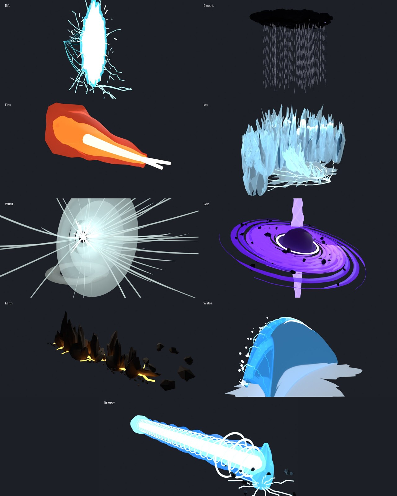

# Element Ultimates

One animated ultimate move per element (Nature uses your own). The models are built in Blender, and
`ElementUltimates.lua` animates them in Roblox. It also adds real particles (fire, smoke, mist,
sparks, dust), dynamic lights, and lightning bolts generated fresh for every strike.



*The previews show the mesh structure at its peak. In game the particles and lighting add the
fire, smoke, mist and sparks on top, which Blender can't preview.*

| Element | Ultimate | What happens | Length |
|---|---|---|---|
| **Rift** | Rips open a rift | Cracks splinter through the air, then a ragged slit rips wide into a blinding white tear with a white-hot edge. Filaments spiral away into its depth, splinters of space drift round it, cyan motes and dark wisps leak out. It snaps shut with a flash | 6.5 s |
| **Electric** | Thunderstorm | A heavy black cloud boils up overhead, churning with smoke, and rain pours. Lightning strikes at random in an irregular rhythm, sometimes two at once. Every bolt is generated fresh, with branches, a double flicker, sparks, dust and a flash lighting the ground and cloud | 7.5 s |
| **Fire** | Flames from the hands | Particle fire pours from both hands into a roaring stream, with a white-hot core, heat-shimmer shells, embers and smoke rolling off the end. A flickering orange light washes over everything | 6.2 s |
| **Ice** | Stomp → ice wall | The stomp throws up ice chips and mist, frost and cracks race across the ground, spikes punch up along the path, then an arc of craggy, splintered ice slabs bursts up section by section with a rumble. It shatters in the same order | 7.4 s |
| **Wind** | Wind clap | The user claps their own hands (play this at the moment of the clap): a sharp burst of compressed air, shockwave shells punching forward from the hands, streaks of wind, a ring of air and dust blasting out along the ground, grit kicked away | 2 s |
| **Void** | Black hole | A black hole implodes into being, the accretion disc unfurls and spins, polar jets shoot up and down, and debris spirals in and gets crushed. It snaps shut with a flash | 8 s |
| **Earth** | Earthsplitter | The stomp throws up dust and rock chips, a molten fissure rips 30 studs forwards, slabs of ground heave up and tilt away from it, jagged spires erupt from the crack, boulders tear loose and float round the user, then slam down as everything sinks back | 6.8 s |
| **Water** | Tidal wave | A wall of water surges up out of the ground in front of the user, rolls forwards curling over with foam on its lip and spray flying, then crashes down in a burst of droplets and mist and spreads out as foam | 6.5 s |
| **Energy** | Kamehameha | Energy gathers into a ball at the hip while a ki aura blazes, the ground cracks and rocks lift into the air. Then the thrust: the ball snaps to the front, shockwave rings punch out and a huge beam blasts 60 studs forwards with its bulbous head, ripping up dust along the ground, before it thins away | 6.2 s |

## Setup in Studio

1. **Import** the `*Ultimate.fbx` files (Home → Import 3D; you can select all at once). The
   default settings are fine.
2. Create a Folder **`ElementUltimateModels`** in `ReplicatedStorage` and put the models in it.
   Keep the model and part names (`Edge`, `Abyss`, `Wall_03`, `Spike_05`...) because the animation
   finds the parts by name. Keep the tiny `Start`, `End` and `Top` marker parts too.
3. Add **`ElementUltimates.lua`** to `ReplicatedStorage` as a ModuleScript named `ElementUltimates`.
4. Play an ultimate:

```lua
local ElementUltimates = require(game.ReplicatedStorage.ElementUltimates)

-- at the caster's feet, facing where they face
ElementUltimates.play("Void", ElementUltimates.feet(character))

-- recoloured (repaints the element's glowing parts, particles and lightning)
ElementUltimates.play("Fire", ElementUltimates.feet(character), {
	color = Color3.fromRGB(80, 160, 255), -- blue fire
})

-- a golden Kamehameha
ElementUltimates.play("Energy", ElementUltimates.feet(character), {
	color = Color3.fromRGB(255, 215, 70),
})

-- other options
ElementUltimates.play("Ice", ElementUltimates.feet(character), {
	size = 1.5,                                   -- scale the whole effect
	colors = { Wall = Color3.fromRGB(...) },      -- per-part colours
	onFinished = function() end,                  -- when the effect has ended
})
```

`play` returns the model and the effect's length in seconds. The effects are purely visual, so do
damage, knockback and hitboxes in your own scripts and time them with that length.

**Tip:** for the smoothest result, play ultimates on each player's client (fire a RemoteEvent to
everyone and call `play` there) instead of on the server.

## Tweaking

Everything lives in `ElementUltimates.lua`:
- `Styles`: the colour, material and transparency of every part
- `Recolorable`: which parts `color` repaints
- `Animations`: the timing and motion of every part, in seconds

The models are generated by `tools/build_element_ultimates.py`. Rerun it with
`python tools/build_element_ultimates.py --render` after changing it.
